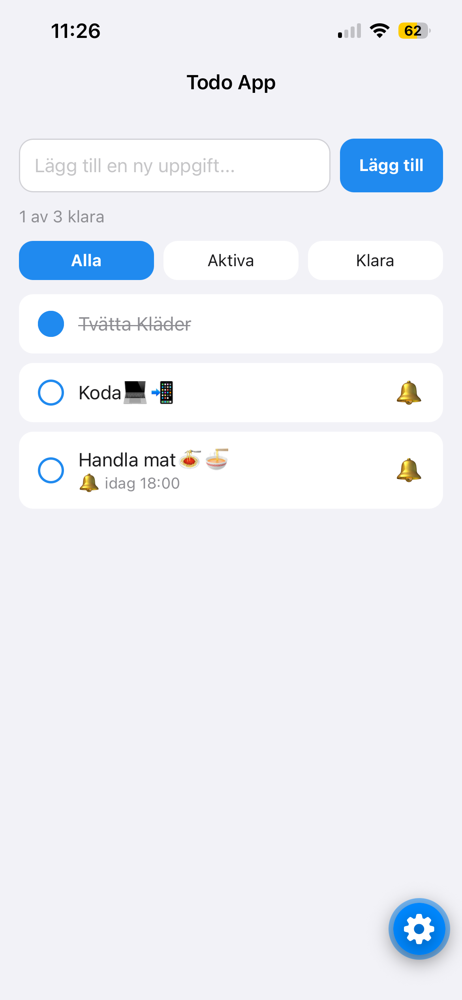
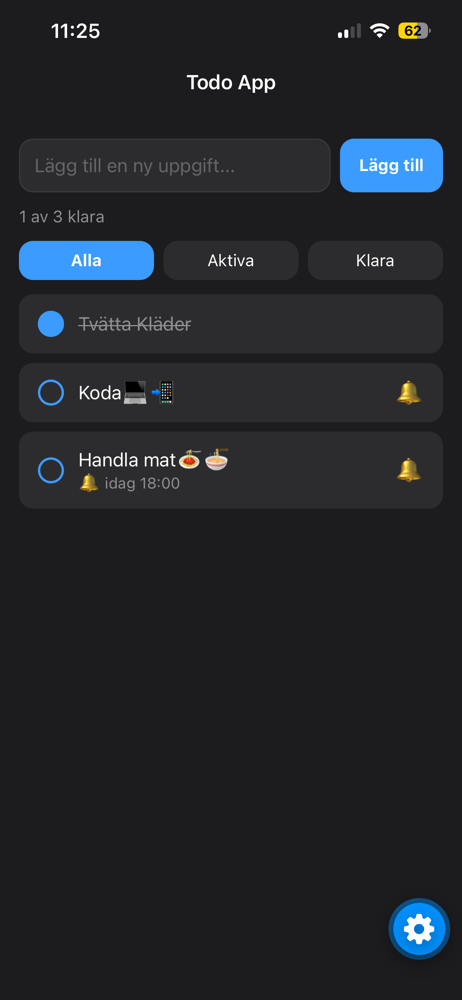

# Todo App

A to-do app for iOS and Android built with React Native and Expo. It started as my first mobile app and a way to learn React Native properly.

<p align="center">
  
  &nbsp;&nbsp;
  
</p>

## Features

- Add, complete and edit tasks (long press to edit)
- Swipe left to delete
- Filter by all, active or done
- Tasks are saved on the device and survive restarts
- Follows the system light and dark mode
- Reminders as local notifications (in 1 hour, tonight or tomorrow morning)

## Tech stack

- [Expo](https://expo.dev) SDK 58 with [Expo Router](https://docs.expo.dev/router/introduction/)
- React Native and TypeScript
- `expo-sqlite/kv-store` for local storage
- `expo-notifications` for reminders
- `react-native-gesture-handler` for swipe to delete

## Getting started

### Prerequisites

- [Node.js](https://nodejs.org) (LTS)
- The [Expo Go](https://expo.dev/go) app on your phone

### Run the app

```bash
git clone https://github.com/Burra17/todo-app.git
cd todo-app
npm install
npx expo start
```

Scan the QR code with the camera (iOS) or the Expo Go app (Android). If the phone can't reach your computer on the network, use a tunnel:

```bash
npx expo start --tunnel
```

When adding packages, use `npx expo install <package>` instead of `npm install` so you get versions that match the Expo SDK.

## Scripts

| Command            | Description               |
| ------------------ | ------------------------- |
| `npm start`        | Start the Expo dev server |
| `npm run lint`     | Lint the code with ESLint |
| `npx tsc --noEmit` | Type check the code       |

## Project structure

```
src/
├── app/           # Screens and navigation (Expo Router, file-based routing)
│   ├── _layout.tsx    # Root layout: navigation stack, theme, gestures
│   └── index.tsx      # The task list screen
├── components/    # Reusable components (TaskItem)
├── constants/     # Light and dark color palettes
└── utils/         # Date helpers for reminders
```

Every file in `src/app/` is a route, so other code lives outside that folder.

## Git workflow

Each GitHub issue gets its own branch, named with a prefix:

| Prefix     | Used for                      | Example               |
| ---------- | ----------------------------- | --------------------- |
| `feature/` | New functionality             | `feature/add-task`    |
| `fix/`     | Bug fixes                     | `fix/reminder-time`   |
| `docs/`    | Documentation                 | `docs/readme`         |
| `chore/`   | Cleanup, refactoring, tooling | `chore/code-comments` |

- Commit messages are written in English, in the imperative mood: `Add delete button to tasks`, not `Added ...`.
- Open a pull request with `Closes #<issue>` in the description so the issue closes on merge.
- Branches are deleted on GitHub automatically after merge. Clean up locally with:

```bash
git checkout main
git pull
git branch -d <branch>
```

## License

[MIT](LICENSE)
